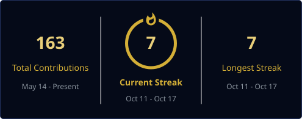

---

## 🙋‍♂️ About Me

<table>
<tr>
<td width="60%" valign="top">

### 👋 Assalam-o-Alaikum, I'm Rafay!

🎓 BS **Artificial Intelligence** @ **Air University, Islamabad** 
💼 Machine Learning & AI Intern — building end-to-end ML projects 
🌍 On a mission: global remote AI/ML internships 
🔭 Currently deepening: **Deep Learning (PyTorch)** & **NLP** 
💬 Ask me about: Recommendation Systems, scikit-learn pipelines, end-to-end ML 
📫 **mabdulrafay1134@gmail.com**

</td>
<td width="40%" valign="top">

### 🏆 Highlights

🥇 **97.5%** — Digit Recognition (SVM) 
🎬 **91.9%** — Netflix Type Prediction 
💳 **75% · F1 0.83** — Credit Scoring 
📦 **7** end-to-end ML projects 
🎓 **3** internships completed

</td>
</tr>
</table>

## 🛠️ Skills & Tools

**ML:** Classification • Regression • Clustering (K-Means) • Recommendation Systems • Model Evaluation • Feature Engineering • Data Preprocessing

## 📌 Featured Projects

| Project | What it does | 🏆 Best Result |
|---|---|---|
| [🎬 Netflix ML Projects](https://github.com/mabdulrafay7zip/Netflix_ML_Projects) | Recommendation system, content-type prediction, rating classification & K-Means segmentation on 8,787 Netflix titles — [▶ Live Demo](https://mabdulrafay7zip.github.io/Netflix-Recommender-Live-Demo/) | **91.9% accuracy** |
| [🤟 Sign Language Recognition](https://github.com/mabdulrafay7zip/Sign-Language-Recognition) | ASL alphabet classifier on Sign Language MNIST (27K images, 24 letters) — SVM vs Random Forest vs MLP, plus webcam demo | **83.7% accuracy** |
| [💳 Credit Scoring Model](https://github.com/mabdulrafay7zip/CreditScoringModel) | Credit-risk prediction on German Credit data (1,000 applicants) | **75% acc • F1 0.83** |
| [🩺 Disease Prediction](https://github.com/mabdulrafay7zip/DiseasePrediction) | Diabetes prediction from Pima health data (768 patients) | **74% accuracy** |
| [✍️ Handwritten Digit Recognition](https://github.com/mabdulrafay7zip/HandwrittenCharacterRecognition) | Handwritten digit recognition (1,797 images) — SVM vs MLP vs Logistic Regression | **97.5% accuracy** |
| [🎮 Tetris Game — C++](https://github.com/mabdulrafay7zip/Tetris-Game) | Classic Tetris in the terminal — 7 tetrominoes, rotation, line clears, score & levels | **Playable** 🎮 |
| [🌐 Personal Portfolio Website](https://mabdulrafay7zip.github.io/) | Animated personal portfolio — typing hero, scroll reveals, project showcase | **Live site** |

## 📊 GitHub Stats

## 🏆 Achievements

## 🐍 Contribution Snake

## 🎯 2026 Focus

## ⚡ Beyond Code

*Dream: building AI that matters — one model at a time.*

<i>"Theory is not enough — you understand ML only when you build."</i> 
⭐ Explore my repositories and let's connect on LinkedIn!

